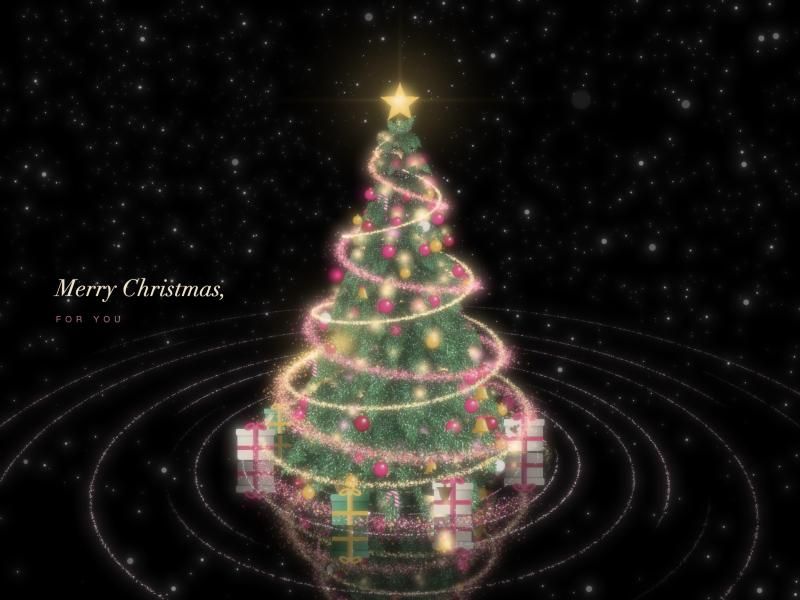

# 雪落成树 · Snow to Tree

一棵可以互动的 3D 圣诞树。整个项目只有一个 `index.html`，不依赖任何框架，也不需要安装或构建。

An interactive 3D Christmas tree in a single HTML file — plain WebGL2, no framework, no build step.



## 它能做什么

- **一棵实体的圣诞树**：枝条和装饰的贴图都是用代码现画的，约 900 片冷杉枝条按 15 层树枝生长，有前后遮挡和明暗。
- **开场动画**：打开时先是一段雪夜，镜头从远处缓缓推近；然后树从下往上一层层长出来，小灯自下而上亮起，两条光带盘旋而上，最后树顶的星星闪亮。
- **雪落成树**：在空白处双击，树从上往下散成漫天的雪；再双击，雪又聚成树。
- **两条光带和"烟花"**：玫红和金色的光带绕着树，一团金光沿着光带爬到树顶，到顶时树尖闪光、地面荡开涟漪。速度可以用滑块调。
- **自己挂灯**：点一下树，就在那里挂上一盏灯。每盏灯是一个音符，点一下就会响；金光经过时只会闪一下。
- **照片**：添加的照片会变成挂在树上的小礼物盒；树散开时，它们是玫红和金色的雪花。点一下打开，以装框的艺术排列展示。
- **手势控制**（可选）：打开摄像头后，用手隔空控制。
- **树是一架竖起来的钢琴**：三角钢琴的弦由长到短，正好是树的形状，所以树底是低音、树尖是高音。键盘 `Z`–`M` 是低音 do 到 si，`Q`–`I` 是高音 do 到高 do；弹到哪个音，树上那一层就泛起金光、光带像琴弦一样颤动，地上一圈细细的琴键也跟着亮。按住 `Shift` 是延音踏板：琴声变长，雪慢下来。右下角「演奏」会弹一首《平安夜》。开场轻触屏幕后，树长出来时会响一串琶音；之后所有声音都由你自己弹。
- **散开后，天上有 15 根弦**：树的 15 层散开后变成天上看不见的弦。上下划过雪就会拨响它们（快速划过就是一串刮奏），被拨响的那根弦上的雪会亮成一条细金线。每张照片都有一段自己的旋律（把照片从左到右当乐谱读：越亮音越高），碰到照片雪花会响它的第一个音，打开照片时会弹完整的一段。

## 怎么打开

用浏览器直接打开 `index.html` 即可。

如果要用摄像头手势，建议通过本地服务器打开（浏览器对摄像头的权限要求更严格）：

```bash
python3 -m http.server 5180
```

然后访问 <http://localhost:5180>。

需要支持 WebGL2 的浏览器：新版 Chrome、Edge 或 Safari。

## 操作

| 操作 | 效果 |
|---|---|
| 拖动 | 旋转视角 |
| 滚轮 / 双指 | 缩放 |
| 点树身 | 挂一盏灯 |
| 点礼物盒或彩色雪花 | 打开照片 |
| 在空白处双击，或按空格 | 散开 / 聚合 |
| 鼠标划过 | 吹散粒子 |
| `H` | 隐藏 / 显示所有按钮和提示 |
| `Esc`、`←` `→` | 关闭照片、切换照片 |

右下角的控制条里有：烟花速度、手势、照片、声音、重新装饰。点最右边的圆钮可以把整条收起。

左下角是去另一个页面的入口（线上网站还有一个「爱心」页面），点它左边的圆钮可以收起，按 `H` 时也会一起隐藏。自己用、没有别的页面时，把 `CONFIG` 里的 `otherPage` 改成 `null`，入口就不显示。

### 手势

| 手势 | 效果 |
|---|---|
| 🖐 张开手掌 | 散开；手的高低控制俯视角度 |
| ✊ 握拳 | 聚合 |
| 手偏左 / 偏右 | 旋转 |
| ☝️ 伸出食指 | 放大离镜头最近的那张照片 |

## 隐私

- **照片不保存、不上传。** 用「照片」按钮添加的照片只存在于当前页面的内存里，刷新或关闭页面后就没有了。
- **摄像头画面只在本机处理**，不会发送到任何地方。摄像头只在点了「手势」之后才打开。
- 浏览器的 `localStorage` 里只记这几样东西：你挂的灯的位置、声音开关、控制条和烟花速度的设置、左下角入口是否收起。
- 手势识别库和模型在第一次使用时从 jsDelivr 和 Google 的服务器下载（约 18MB）。除此之外，页面不发出任何网络请求。

## 自己修改

打开 `index.html`，最上面有一段带中文注释的 `CONFIG`，可以改：

- 标题和副标题
- 颜色
- 粒子数量、小暖灯数量、装饰的多少、枝叶上的积雪
- 树的自转速度、光带的粗细、烟花速度
- 开场动画的节奏：`introSnow`（先下几秒雪）、`introGrow`（树用几秒长出来）
- `photos`：想让照片一打开就在树上，把图片放进 `photos` 文件夹并在这里列出文件名

**加自己的曲子**：在 `songs/local.js` 里用简谱写（格式说明在 `index.html` 的 `parseScore` 上方，也可以照着《平安夜》以外的例子写），右下角「演奏」左边的曲名点一下就能换歌。这个文件只在本机打开页面时读取，`songs/` 文件夹不进仓库、也不会被部署——有版权的歌放在这里，自己听没问题，但不要公开发布。

改完保存，刷新浏览器就能看到。

## 已知情况

- 主要在桌面版 Chrome 上开发和检查，手机上没有充分测试。
- 手势识别需要联网下载模型，并且需要浏览器允许使用摄像头。

## 致谢

- 手势识别使用 Google 的 [MediaPipe Gesture Recognizer](https://ai.google.dev/edge/mediapipe/solutions/vision/gesture_recognizer)。
- "张开手掌散开、握拳聚合"的手势玩法参考了 [moleculemmeng020425/christmas-tree](https://github.com/moleculemmeng020425/christmas-tree)。本项目的代码是独立编写的。

## 许可

[MIT](LICENSE)
